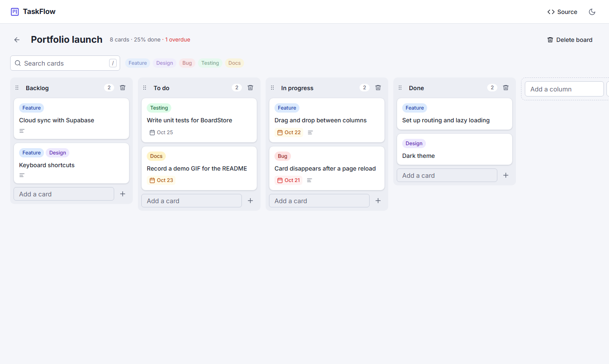
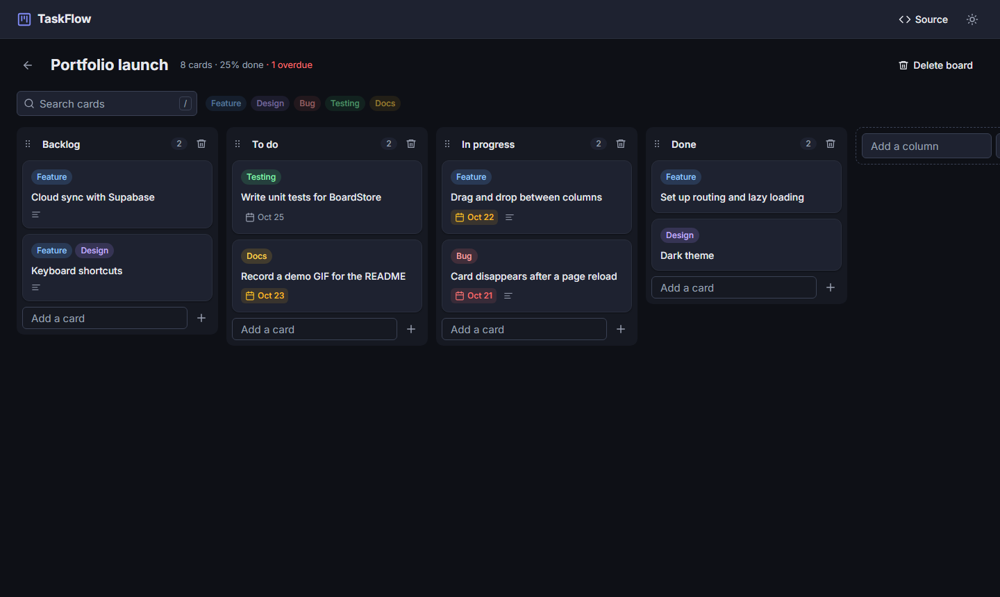

# TaskFlow

A Kanban board built with **Angular 21**: boards, columns and cards you can drag around, edit and filter. Everything is saved in the browser, so it works without an account or a backend.

[](https://github.com/sonik-boom71/angular-taskflow/actions/workflows/ci.yml)


**Live demo:** LIVE_DEMO_URL



<details>
<summary>Dark theme</summary>



</details>

## Features

- **Boards:** create, rename and delete boards; each tile shows card count, progress and overdue cards.
- **Drag and drop:** move cards within and between columns, and reorder the columns themselves.
- **Cards:** edit the title, description, due date and labels in a dialog with validation.
- **Deadlines:** cards are highlighted when they're overdue, due today or due in the next two days.
- **Search and filters:** search titles and descriptions, filter by one or more labels. Press <kbd>/</kbd> to jump to search.
- **Inline editing:** click a board or column name to rename it; <kbd>Enter</kbd> saves, <kbd>Esc</kbd> cancels.
- **Light and dark themes:** follows the system setting, remembers your choice, and never flashes the wrong theme on load.
- **Works on phones:** columns scroll sideways and snap into place; press and hold a card to drag it.
- **Saved locally:** state lives in `localStorage`, and demo boards appear on the first visit.

## What it shows about Angular

| Topic                        | Where to look                                                                                                       |
| ---------------------------- | ------------------------------------------------------------------------------------------------------------------- |
| Signals for state            | [`BoardStore`](src/app/core/services/board-store.ts): `signal`, `computed`, and an `effect` that saves to storage   |
| Immutable updates            | Every store method returns new objects; a no-op change keeps the same reference, so nothing re-renders              |
| Standalone, OnPush, zoneless | All components are standalone with `OnPush`; the app runs without zone.js                                           |
| Signal inputs and outputs    | `input()`, `input.required()`, `output()`, `viewChild()` throughout [`features/board`](src/app/features/board)      |
| Built-in control flow        | `@if`, `@for` with `track`, `@empty`, `@let` in the templates                                                       |
| Routing                      | Lazy-loaded pages, route params bound to inputs (`withComponentInputBinding`), a 404 page                           |
| Route guard                  | [`boardExistsGuard`](src/app/core/guards/board-exists.guard.ts) redirects to the list when a board id doesn't exist |
| Reactive forms               | Typed `FormGroup` with built-in and custom validators in [`CardDialog`](src/app/features/board/card-dialog.ts)      |
| Angular CDK                  | Nested drag and drop lists (cards inside draggable columns), drag handles, auto-scrolling                           |
| Dependency injection         | `inject()`, root services, and a swappable `StorageService` that tests replace with an in-memory fake               |
| Accessibility                | Native `<dialog>`, labelled controls, `aria-pressed` filters, keyboard support, `prefers-reduced-motion`            |

## Tech stack

Angular 21 · TypeScript (strict) · Angular CDK · SCSS with CSS custom properties · Vitest · ESLint (angular-eslint) · Prettier · GitHub Actions · Vercel

No UI library: the design system (tokens, buttons, inputs, labels, themes) is hand-written in [`styles.scss`](src/styles.scss).

## Project structure

```
src/app
├── core
│   ├── data          # board factory and demo data
│   ├── guards        # boardExistsGuard
│   ├── models        # Board, Column, Card, Label types
│   ├── services      # BoardStore, StorageService, ThemeService
│   └── utils         # due status, card filter, board stats (pure functions)
├── features
│   ├── boards        # boards list page
│   ├── board         # board page, column, card, card dialog
│   └── not-found     # 404 page
├── layout            # app header
└── shared
    ├── ui            # Icon, InlineEdit
    └── validators.ts
```

The board page is a container: it reads from `BoardStore` and passes data down. `BoardColumn`, `CardItem` and `CardDialog` are presentational components that only use inputs and outputs.

## Getting started

You need Node.js 20.19+, 22.12+ or 24+.

```bash
git clone https://github.com/sonik-boom71/angular-taskflow.git
cd angular-taskflow
npm ci
npm start
```

Then open http://localhost:4200.

| Command                | What it does                        |
| ---------------------- | ----------------------------------- |
| `npm start`            | Dev server with live reload         |
| `npm test`             | Unit tests in watch mode (Vitest)   |
| `npm run test:ci`      | Unit tests once                     |
| `npm run lint`         | ESLint for TypeScript and templates |
| `npm run format:check` | Prettier check                      |
| `npm run build`        | Production build in `dist/taskflow` |

## Tests

40 unit tests cover the store (every mutation, persistence, no-op moves), the pure helpers, the route guard, and the main components through their rendered DOM: form validation in the card dialog, creating a board, and inline editing.

CI runs lint, format check, tests and a production build on every push and pull request.

## Deployment

The app is deployed on Vercel from the `main` branch. [`vercel.json`](vercel.json) sets the output folder and rewrites every path to `index.html`, so deep links like `/board/demo` work after a page refresh.

## Ideas for next steps

- Cloud sync and sign-in with Supabase
- Keyboard shortcuts for creating and moving cards
- Card checklists and comments
- End-to-end tests with Playwright

## License

[MIT](LICENSE)
