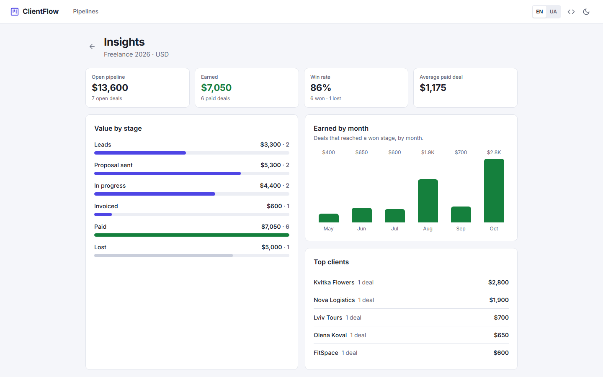
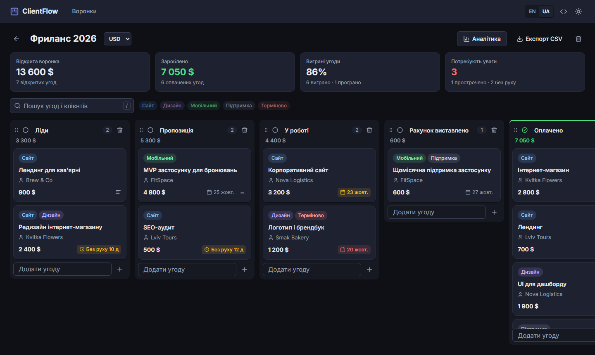
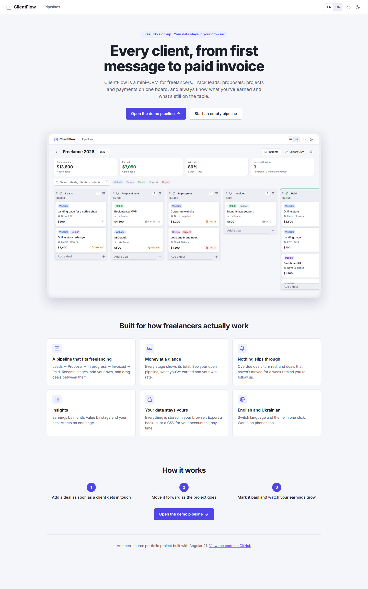

# ClientFlow

**A mini-CRM for freelancers.** Track every client from first message to paid invoice: leads, proposals, projects and payments on one board, with earnings insights. No sign-up, no backend: data stays in the browser. English and Ukrainian.

[](https://github.com/sonik-boom71/angular-clientflow/actions/workflows/ci.yml)


**Live demo:** https://angular-clientflow.vercel.app


## Why it exists

Freelancers juggle a dozen conversations at once: a lead from Telegram, a proposal waiting for an answer, two projects in progress and an invoice nobody has paid. Spreadsheets don't show what's stuck, and full CRMs are built for sales teams. ClientFlow is the small tool in between.

## Features

- **Freelance pipeline out of the box:** Leads → Proposal sent → In progress → Invoiced → Paid / Lost. Rename, add, reorder and retype stages.
- **Deals with the details that matter:** project, client, contact, amount, due date, labels and notes.
- **Money at a glance:** every stage shows its total, and the board header shows the open pipeline, earnings, win rate and what needs attention.
- **Follow-up reminders:** overdue deals turn red, and open deals that haven't moved for a week without a planned date get an "idle" badge.
- **Activity history:** each deal logs when it was created and every stage it moved through.
- **Insights page:** value by stage, earnings by month and top clients.
- **Drag and drop:** move deals between stages and reorder the stages themselves, on desktop and touch screens.
- **Search and filters:** by project, client, contact or notes, and by label. Press <kbd>/</kbd> to search.
- **Export and backup:** CSV for an accountant (Excel-friendly, safe against formula injection), and a JSON backup you can restore.
- **English and Ukrainian:** switch without a reload, with proper Ukrainian plurals (1 угода, 2 угоди, 5 угод) and local number and date formats.
- **Light and dark themes,** remembered per browser, with no flash on load.

<details>
<summary>More screenshots</summary>

**Insights**



**Ukrainian interface, dark theme**



**Landing page**



</details>

## What it shows about Angular

| Topic                         | Where to look                                                                                                                                                        |
| ----------------------------- | -------------------------------------------------------------------------------------------------------------------------------------------------------------------- |
| Signals for state             | [`BoardStore`](src/app/core/services/board-store.ts): `signal`, `computed`, and an `effect` that persists to storage                                                 |
| Immutable updates             | Every store method returns new objects; a no-op change keeps the same reference, so nothing re-renders or re-saves                                                   |
| Runtime i18n without a reload | [`I18n`](src/app/core/i18n/i18n.service.ts) service, typed keys (a missing Ukrainian string is a compile error), `Intl.PluralRules`, impure pipes driven by a signal |
| Custom `TitleStrategy`        | [`TranslatedTitleStrategy`](src/app/core/i18n/translated-title.strategy.ts): route titles are translation keys and update when the language changes                  |
| Data migration                | [`normalizeBoards`](src/app/core/data/normalize.ts) validates storage and imported files, and upgrades data from the earlier TaskFlow version                        |
| Standalone, OnPush, zoneless  | All components are standalone with `OnPush`; the app runs without zone.js                                                                                            |
| Signal inputs and outputs     | `input()`, `input.required()`, `output()`, `viewChild()`; a container page and presentational components in [`features/board`](src/app/features/board)               |
| Routing                       | Lazy-loaded pages, route params bound to inputs (`withComponentInputBinding`), a [route guard](src/app/core/guards/board-exists.guard.ts), a 404 page                |
| Reactive forms                | Typed `FormGroup` with built-in and custom validators in [`CardDialog`](src/app/features/board/card-dialog.ts)                                                       |
| Angular CDK                   | Nested drag and drop (deals inside draggable stages), drag handles, touch delay, auto-scroll                                                                         |
| Pure business logic           | Stats, deal health, filters and CSV in [`core/utils`](src/app/core/utils) are plain functions, tested without Angular                                                |
| Accessibility                 | Native `<dialog>`, labelled controls, `aria-pressed` toggles, `role="status"` messages, keyboard support, `prefers-reduced-motion`                                   |

## Tech stack

Angular 21 · TypeScript (strict) · Angular CDK · SCSS with CSS custom properties · Vitest · ESLint (angular-eslint) · Prettier · GitHub Actions · Vercel

No UI library: the design system (tokens, buttons, inputs, labels, charts, themes) is hand-written in [`styles.scss`](src/styles.scss) and the component styles.

## Project structure

```
src/app
├── core
│   ├── data          # default pipeline, demo data, validation and migration
│   ├── guards        # boardExistsGuard
│   ├── i18n          # I18n service, EN/UK dictionaries, pipes, title strategy
│   ├── models        # Board (pipeline), Column (stage), Card (deal)
│   ├── services      # BoardStore, StorageService, ThemeService, DownloadService
│   └── utils         # stats, deal health, filters, CSV and backup (pure functions)
├── features
│   ├── landing       # product landing page
│   ├── pipelines     # pipelines list, backup import and export
│   ├── board         # board page, stage column, deal card, deal dialog
│   ├── insights      # charts and top clients
│   └── not-found
├── layout            # header with language and theme switches
└── shared
    ├── ui            # Icon, InlineEdit, KpiStrip
    └── validators.ts
```

The Kanban core is generic (board → column → card). The CRM layer adds amounts, clients, stage types (open, won, lost) and activity history on top of it.

## Getting started

You need Node.js 20.19+, 22.12+ or 24+.

```bash
git clone https://github.com/sonik-boom71/angular-clientflow.git
cd angular-clientflow
npm ci
npm start
```

Then open http://localhost:4200.

| Command                | What it does                          |
| ---------------------- | ------------------------------------- |
| `npm start`            | Dev server with live reload           |
| `npm test`             | Unit tests in watch mode (Vitest)     |
| `npm run test:ci`      | Unit tests once                       |
| `npm run lint`         | ESLint for TypeScript and templates   |
| `npm run format:check` | Prettier check                        |
| `npm run build`        | Production build in `dist/clientflow` |

## Tests

76 unit tests cover:

- **Store:** every mutation, stage history, the idle timer, no-op updates, persistence, migration from v1.
- **Data validation:** broken or old data is repaired instead of crashing the app.
- **Business logic:** win rate, earnings by month, top clients, deal health, filters.
- **Export:** CSV quoting and formula defusing, backup round trips.
- **i18n:** all three Ukrainian plural forms, interpolation, money formats per locale.
- **Components through their DOM:** deal form validation, backup import, landing actions, the live language switch.

CI runs lint, format check, tests and a production build on every push and pull request.

## Deployment

Deployed on Vercel from the `main` branch. [`vercel.json`](vercel.json) sets the output folder and rewrites every path to `index.html`, so deep links like `/board/demo/insights` work after a refresh.

## Ideas for next steps

- Cloud sync and sign-in with Supabase, so the pipeline follows you across devices
- Invoice PDFs generated from a deal
- Recurring deals for retainers
- End-to-end tests with Playwright

## License

[MIT](LICENSE)
