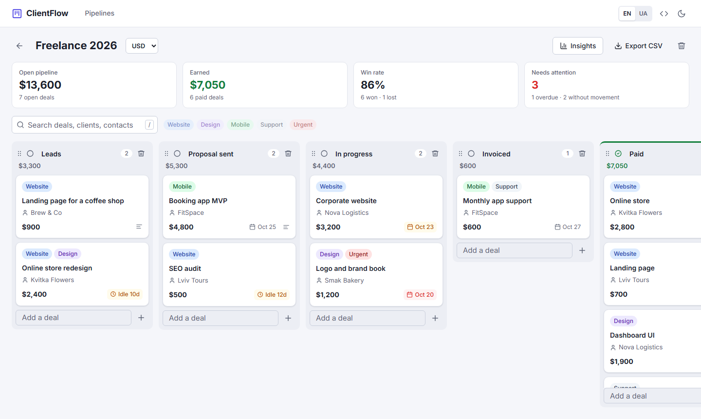

# ClientFlow

A mini-CRM for freelancers: track every client from the first message to a paid invoice.

[](https://github.com/sonik-boom71/angular-clientflow/actions/workflows/ci.yml)

**Live demo:** https://angular-clientflow.vercel.app



## Features

- Deal pipeline: Leads → Proposal sent → In progress → Invoiced → Paid / Lost
- Drag and drop for deals and stages
- Client, contact, amount, due date, labels and notes for each deal
- Stage totals, earnings, win rate and reminders for overdue or idle deals
- Insights: earnings by month, value by stage, top clients
- CSV export and JSON backup
- English and Ukrainian, light and dark theme
- No sign-up: data is stored in the browser

## Tech stack

Angular 21, TypeScript, Angular CDK, SCSS, Vitest, ESLint, Prettier, GitHub Actions, Vercel.

## Getting started

```bash
npm ci
npm start
```

Open http://localhost:4200.

Other commands: `npm test`, `npm run lint`, `npm run build`.

## License

[MIT](LICENSE)
